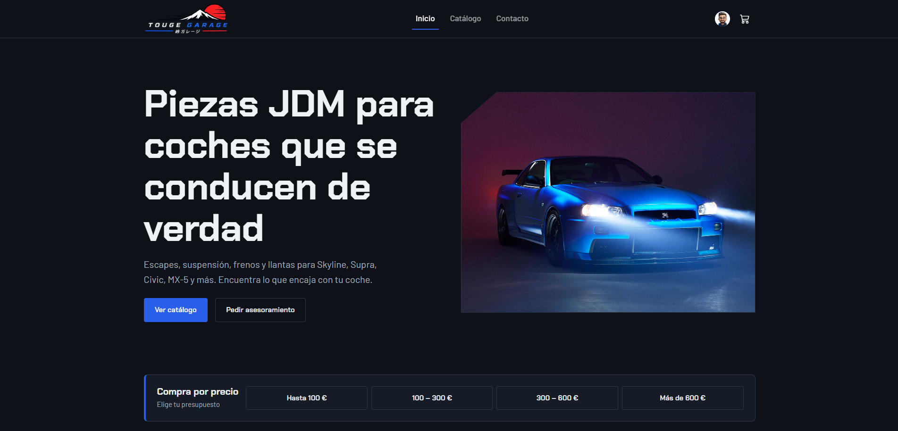
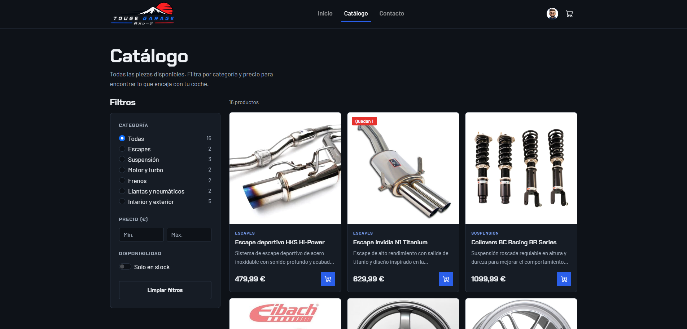
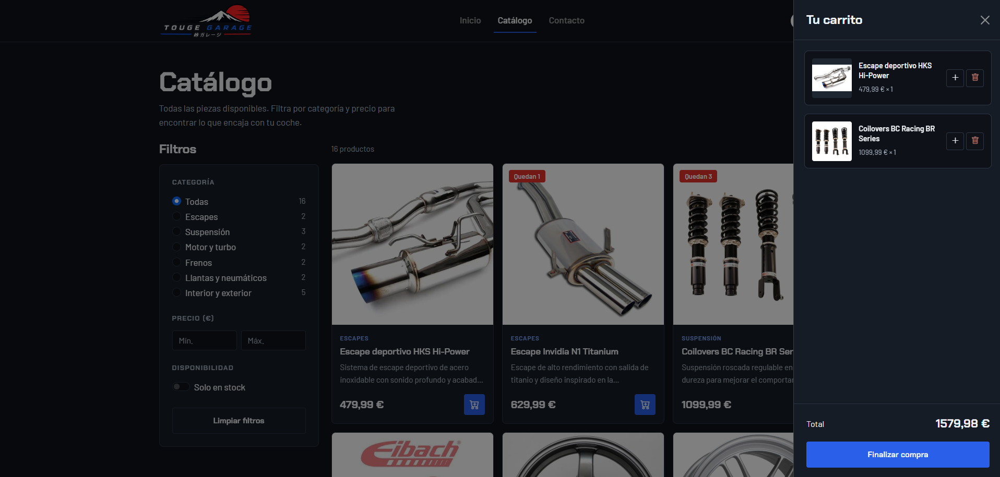
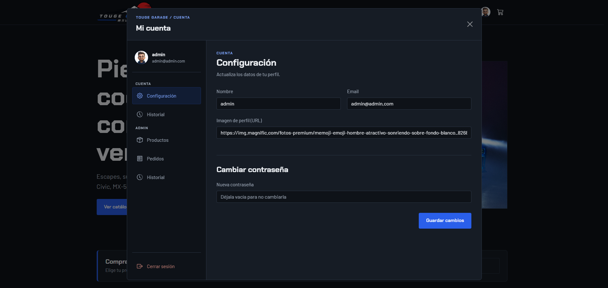
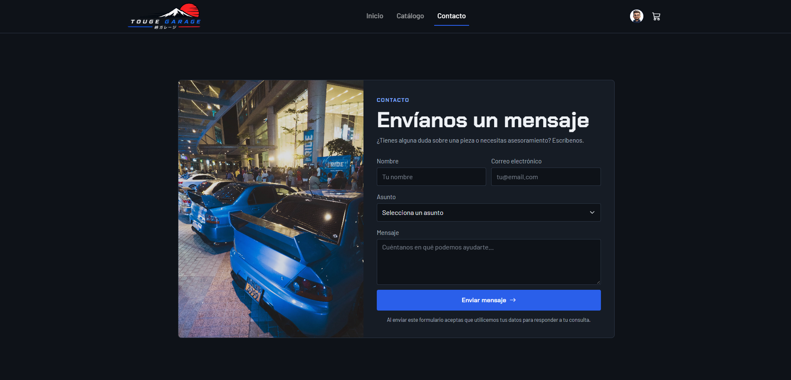

# Touge Garage

Tienda online de demostración para piezas JDM y de tuning. Incluye catálogo, filtros, carrito, cuentas de usuario y herramientas de administración. La interfaz está en español.

## Contenido

- [Capturas](#capturas)
- [Funciones](#funciones)
- [Tecnologías](#tecnologías)
- [Requisitos](#requisitos)
- [Instalación y ejecución local](#instalación-y-ejecución-local)
- [Configuración de MongoDB](#configuración-de-mongodb)
- [Primer acceso de administrador](#primer-acceso-de-administrador)
- [Estructura del proyecto](#estructura-del-proyecto)
- [Funcionamiento](#funcionamiento)
- [API](#api)
- [Modelos de la API](#modelos-de-la-api)
- [Desarrollo y pruebas](#desarrollo-y-pruebas)

## Capturas

### Inicio



### Catálogo



### Carrito



### Configuración



### Contacto



## Funciones

- Página de inicio y páginas de contacto y confirmación.
- Catálogo de productos con filtros por categoría, precio y disponibilidad. Los filtros se reflejan en la URL.
- Registro e inicio de sesión.
- Carrito asociado a la cuenta: al añadir un producto se reserva stock; al quitarlo o cancelar un pedido se devuelve.
- Cuenta de usuario con edición de perfil e historial de pedidos.
- Panel de administración para crear, editar y eliminar productos; revisar pedidos pendientes y aceptar o cancelar pedidos.
- Actualización del catálogo cuando cambia el inventario.

El formulario de contacto es solo visual: redirige a la página de confirmación y no envía ni almacena mensajes.

## Tecnologías

| Parte | Tecnología |
| --- | --- |
| Interfaz | HTML, CSS y JavaScript nativo con módulos ES |
| Componentes y estilos | Bootstrap 5.3.3 y Bootstrap Icons 1.11.3, cargados desde CDN |
| Tipografías | Barlow y Chakra Petch, cargadas desde Google Fonts |
| API | PHP |
| Base de datos | MongoDB |
| Dependencias PHP | `mongodb/mongodb` y `vlucas/phpdotenv`, gestionadas por Composer |

No hay un proceso de compilación del frontend ni dependencias JavaScript que instalar con `npm install`. Node.js/npm solo se necesitan para ejecutar los scripts auxiliares de `package.json`.

## Requisitos

- PHP **8.1 o superior**.
- Extensión PHP **MongoDB 1.21 o superior**.
- Composer.
- Node.js y npm, opcionales si se inicia el servidor directamente con PHP.
- Conexión a Internet para cargar Bootstrap, Bootstrap Icons y Google Fonts desde sus CDN.

## Instalación y ejecución local

1. Clona el repositorio y entra en su raíz:

   ```sh
   git clone <URL_DEL_REPOSITORIO>
   cd tienda
   ```

2. Instala las dependencias de PHP: (Recuerda tener compose y la extension de mongoDB para PHP instalada)

   ```sh
   composer install
   ```

3. Edita `.env`

4. Desplegamos la api
   ```sh
   npm run dev
   ```

5. Abre <http://localhost:3000/pages/index.html>.

## Estructura del proyecto

```text
.
├── db/
│   ├── config/          # Conexión a MongoDB y carga de .env
│   ├── controllers/     # Lógica de usuarios, productos y pedidos
│   ├── models/          # Esquemas de documentos
│   ├── routes/          # Enrutamiento de la API
│   ├── utils/           # Utilidades de MongoDB
│   └── server.php       # Router PHP y punto de entrada de la API
├── public/
│   ├── assets/          # Imágenes y recursos estáticos
│   ├── constants/        # Rutas, eventos y valores compartidos
│   ├── css/             # Estilos
│   ├── js/              # Módulos de interfaz
│   ├── pages/           # Páginas HTML
│   └── utils/           # API del frontend, formularios y utilidades
├── readme-assets/       # Capturas destinadas a este README
├── .env.example         # Plantilla de configuración local
├── composer.json        # Dependencias PHP
└── package.json         # Scripts locales
```

## Funcionamiento

1. El navegador carga las páginas estáticas desde `public/`.
2. Los módulos JavaScript llaman a la API en `/api`, definida en `public/constants/api.js`.
3. `db/server.php` deriva las peticiones a las rutas de usuarios, productos o pedidos.
4. Los controladores validan la petición y consultan o actualizan las colecciones de MongoDB.
5. La API responde en JSON; el frontend actualiza la interfaz.

El carrito reserva inventario al añadir artículos. Al finalizar la compra, pasa a pedido pendiente; la administración puede aceptarlo o cancelarlo. Al cancelar, el stock se devuelve.

## API

Las rutas de la API usan el prefijo `/api`. Las operaciones principales que consume la interfaz son:

| Método | Ruta | Uso |
| --- | --- | --- |
| `GET` | `/api/products` | Listar productos |
| `GET` | `/api/products?id=<id>` | Consultar un producto |
| `POST` | `/api/products` | Crear un producto; requiere `userId` de administrador en el JSON |
| `PUT` | `/api/products?id=<id>` | Actualizar un producto; requiere `userId` de administrador |
| `DELETE` | `/api/products?id=<id>` | Eliminar un producto; requiere `userId` de administrador |
| `POST` | `/api/users?action=register` | Registrar una cuenta |
| `POST` | `/api/users?action=login` | Iniciar sesión |
| `GET` | `/api/orders?userId=<id>` | Obtener el carrito de una cuenta |
| `POST` | `/api/orders` | Añadir un producto al carrito |
| `DELETE` | `/api/orders?productId=<id>` | Quitar un producto del carrito |
| `PUT` | `/api/orders?checkout=1` | Convertir el carrito en pedido pendiente |
| `GET` | `/api/orders?adminId=<id>` | Listar pedidos pendientes |
| `GET` | `/api/orders?history=user&userId=<id>` | Consultar el historial de una cuenta |
| `GET` | `/api/orders?history=admin&adminId=<id>` | Consultar el historial de administración |
| `PUT` | `/api/orders?id=<id>` | Aceptar o cancelar un pedido |

Las operaciones que modifican el carrito y finalizan la compra también reciben el identificador de usuario en el JSON.

## Modelos de la API

Los modelos PHP están en `db/models/`. MongoDB genera `_id` para cada documento; al serializar un `ObjectId` en JSON aparece como `{ "$oid": "..." }`.

### Producto ([Product](db/models/Product.php))

| Campo | Tipo | Descripción |
| --- | --- | --- |
| `_id` | ObjectId | Identificador generado por MongoDB |
| `name` | string | Nombre del producto |
| `description` | string | Descripción |
| `price` | number | Precio |
| `image` | string | URL o ruta de la imagen |
| `category` | string | Categoría |
| `stock` | integer | Unidades disponibles |

### Usuario ([User](db/models/User.php))

| Campo | Tipo | Descripción |
| --- | --- | --- |
| `_id` | ObjectId | Identificador generado por MongoDB |
| `name` | string | Nombre |
| `email` | string | Correo electrónico |
| `password` | string | Contraseña proporcionada al registrarse |
| `admin` | boolean | Indica si la cuenta es administradora |
| `image` | string o `null` | Imagen de perfil |

### Pedido ([Order](db/models/Order.php))

| Campo | Tipo | Descripción |
| --- | --- | --- |
| `_id` | ObjectId | Identificador generado por MongoDB |
| `user_id` | ObjectId o `null` | Usuario propietario |
| `products` | array | Productos incluidos en el carrito o pedido |
| `products[].product_id` | ObjectId o `null` | Identificador del producto |
| `products[].quantity` | integer | Cantidad |
| `total` | number | Total del pedido |
| `status` | string | `cart`, `pending`, `accepted` o `cancelled` |
| `created_at` | fecha, opcional | Fecha de finalización de la compra |

La respuesta del endpoint del carrito tiene la forma `{ "products": [...], "total": 0 }`. Cada producto incluye `product_id`, `name`, `description`, `price`, `image` y `quantity`.
